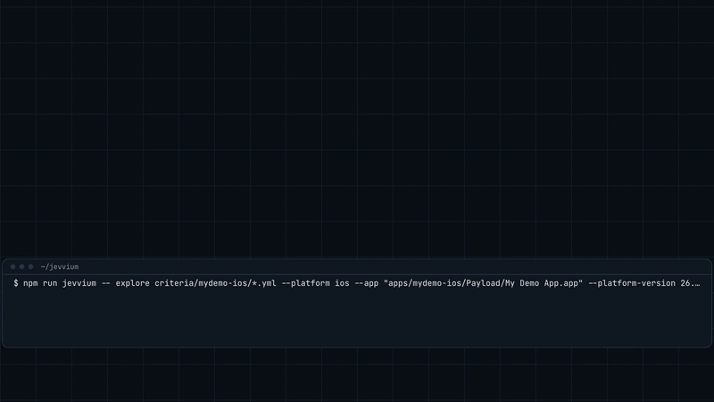

# jevvium

[](https://github.com/AndresCarreonDiaz/jevvium/actions/workflows/ci.yml)

**Turn a test plan written in plain words into an Appium test.** Write the steps the way you'd write them in a PR description or a ticket. A decision model follows them through the app, one tap, one keystroke, one scroll at a time. jevvium writes that path down as a plain WebdriverIO test, with fixed selectors and real assertions, replays it once with plain Appium to prove it passes on its own, and hands it over to run in CI with no AI in the loop.



Five acceptance criteria of Sauce Labs' demo shop app, explored on four iOS Simulators at once in 22.0 s, played here at 2x. Four passed and became tests; the fifth stopped, because the app sorts its prices as text. The run's traces are in [`benchmarks/2026-09-29-parallel`](benchmarks/2026-09-29-parallel/four-simulators-video).

```markdown
# Add the bike light to the cart

1. In the catalog, scroll down until the Sauce Labs Bike Light shows, and open it
2. Add it to the cart, then open the Cart tab

Expected: "My Cart" and "Sauce Labs Bike Light"
```

```
$ npx jevvium explore criteria/mydemo-ios/bike-light.md --app "apps/mydemo-ios/Payload/My Demo App.app"
Simulator: iPhone 17, iOS 26.5
Starting Appium (log: runs/appium.log)

bike-light: Add the bike light to the cart
Starting the Appium session (a first session on a simulator builds WebDriverAgent with Xcode: a minute or a few)
(session ready in 2.7 s)
(input: direct to the simulator)
   1  scroll down the screen                  0.88 · 200 ms
   2  tap "Sauce Labs Bike Light"             1.00 · 100 ms
   3  step 1 done                             goal 0.75 · 80 ms
   4  tap "Add To Cart"                       0.99 · 104 ms
   5  tap "Cart-tab-item"                     0.98 · 96 ms
   6  goal reached                            goal 0.92 · 89 ms
  PASSED in 6.7s: Goal reached and all 2 expectations hold.
  replayed with plain Appium in 5.9s: passed
  trace: runs/bike-light.ios.1791666938567.json
  test:  generated/bike-light.ios.spec.ts

1 criterion in 18.6 s (2.7 s of it starting the session): 1 passed
```

Each line is one decision: what it did, how sure the model was, and how long the model took to answer. The bike light is below the fold, so the first decision scrolled the catalog. The test it wrote, named after the plan and headed by the plan's own steps ([`examples/ios-plans/bike-light.ios.spec.ts`](examples/ios-plans/bike-light.ios.spec.ts)):

```ts
describe('bike-light', () => {
  it('Add the bike light to the cart', async () => {
    // 1. In the catalog, scroll down until the Sauce Labs Bike Light shows, and open it
    await browser.swipe({ direction: 'up', duration: 1000, percent: 0.8, scrollableElement: $('(//XCUIElementTypeCollectionView)[1]') })
    await $('//XCUIElementTypeCell[.//XCUIElementTypeStaticText[@label="Sauce Labs Bike Light"]]').click()
    // 2. Add it to the cart, then open the Cart tab
    await $('~AddToCart').click()
    await $('~Cart-tab-item').click()
    // Expected
    await expect($('-ios predicate string:label == "My Cart"')).toBeDisplayed()
    await expect($('-ios predicate string:label == "Sauce Labs Bike Light"')).toBeDisplayed()
  })
})
```

```
$ npx jevvium test generated/bike-light.ios.spec.ts --app "apps/mydemo-ios/Payload/My Demo App.app"
...
   ✓ Add the bike light to the cart

1 passing (6.6s)
```

([the whole output](examples/ios-plans/bike-light.test-output.txt))

Exploring took 6.7 s with the model deciding every step, for $0.0005 in model calls. The test it wrote runs in 6.6 s, with no model at all ([what each costs](#explore-once-run-as-often-as-you-like-what-each-costs)).

## Why

A new feature ships, and someone has to work out which screens to go through, which elements to use and in what order, and then write that down as a test. The test plan already says what to do; what's missing is the Appium. AI agents that drive the app can work it out, but running one on every CI build is slow, costs money on every run, and doesn't give the same result twice.

jevvium splits the job in two:

1. **Explore once.** A decision model follows the plan, picking each next action from the elements that are actually on screen, until the plan is done.
2. **Run forever.** The path it found becomes an ordinary test. You review it, commit it, and CI runs it like any other test.

If it can be tapped, typed into or scrolled, it can be in the plan.

## How it works

```
plan.md ──► explore loop ───────────────────────────────► replay with plain Appium ──► generated spec ──► CI
              │                                           (proves the steps pass)      (plain WebdriverIO)
              ├─ read the screen
              ├─ list what can be done: tap each button, type each input into each field, scroll each list
              ├─ ask the model: which action next? is the current step done? what goes in each empty field?
              ├─ stop and escalate if its confidence is low
              ├─ at a dead end, restart the app, replay, and try the model's runner-up instead
              └─ act, wait for the screen to settle, repeat
```

Each step is usually one request to [Jev](https://docs.typesafe.ai), TypeSafe's decision model. Jev doesn't write text: it picks one option from a list you give it and says how sure it is. That fits this problem well:

- **It can only pick elements that exist.** The options are built from the page source, so there is no invented selector to debug.
- **It says how sure it is.** When its confidence drops below `--min-confidence`, jevvium stops and reports the step as `escalated` instead of tapping something at random. TypeSafe trains Jev for calibrated probabilities; jevvium hasn't measured how well that holds for this step confidence yet.
- **One request answers every question.** "What next?", "Is the current step done?" and "Which test data goes in each empty field?" go out together and Jev answers them in parallel, so a whole form is filled from one decision.
- **It is fast and cheap.** Asked the same questions as Claude Sonnet 5.5 on the same criteria, it passed 21 of 27 runs to Sonnet's 22, with a median decision of 125 ms against 1.8 s, at $0.071 per 1,000 requests against $5.53 at list prices ([comparison](#jev-against-claude-sonnet-55)).

Pass or fail comes from the `Expected` checks, not from the model: when the model thinks the last step is done, jevvium checks them against the device, and the run only passes if all of them hold. A plan without checks passes on the model's word, and its generated test says so.

## Writing a test plan

A plan is a Markdown file. The runs in this README used [`criteria/mydemo-ios/checkout-plan.md`](criteria/mydemo-ios/checkout-plan.md), [`criteria/mydemo-ios/bike-light.md`](criteria/mydemo-ios/bike-light.md) and [`criteria/login-plan.md`](criteria/login-plan.md).

| Part | How to write it |
| --- | --- |
| Goal | The title (`# Log in`), plus any plain paragraphs: context the model reads, such as where the feature lives |
| Steps | Numbered or bulleted lines, in order. jevvium works through them one at a time, asking the model after each action whether the current step is done. Keep each to one thing a tester would do |
| Test data | `Enter 10 as the amount` or `type "Jane Tester" as their full name` inside a step. The name (`amount`, `full_name`) is what the model sees; the value is typed on the device and written into the test. One verb can give several: `enter 12345 as the zip code and United States as the country`. A `Test data:` section with `name: value` lines works too |
| Expected | `Expected:` lines, or an `## Expected` section. Each quoted string must be on screen, whole, at the end (`"You are logged in!"`); say `contains` for a part of a text (`contains "Order #"`); `id ContinueShopping` is an accessibility id. A line without quotes is taken as the whole text |

Say where things are when it isn't obvious from the screen ("From the Catalog, …", "On the Login screen, …"). End the plan on the screen the checks describe: a plan that adds an item to the cart and checks for the cart's contents should say to open the cart, or the model may well do that on its own and the check for the product page's button fails ([what that looked like](benchmarks/2026-10-10-explore-vs-appium/README.md)). Use made-up test data: the values end up in the test, and selectors keep the app's own labels. Test data must not equal a field's placeholder, because a field showing its placeholder counts as empty.

The YAML form from earlier versions still works: `goal`, `inputs`, `expect`, and now `steps` and `contains` ([`criteria/login.yml`](criteria/login.yml)).

```bash
npx jevvium validate criteria/*.md     # checks the plans, without a device or a key
```

## Tried on Sauce Labs' demo shop app

Sauce Labs publishes [My Demo App](https://github.com/saucelabs/my-demo-app-ios), a shop built to practice test automation on: a catalog, product pages, a cart, and a checkout behind a login with shipping and card forms. The plans and criteria for it are in [`criteria/mydemo-ios`](criteria/mydemo-ios); the traces and tests from these runs are in [`examples/ios-plans`](examples/ios-plans) and [`examples/ios-mydemo`](examples/ios-mydemo) (iOS 26.5 simulator, `jev-1.13.0`):

| Plan or criterion | Outcome | Decisions | Exploring | Replay with plain Appium |
| --- | --- | --- | --- | --- |
| Buy a backpack ([a six-step plan with two forms](criteria/mydemo-ios/checkout-plan.md)) | passed | 17 | 15.4 s | failed (see below) |
| Add the bike light to the cart (the plan above: it is below the fold) | passed | 6 | 6.7 s | passed, 5.9 s |
| Add a backpack to the cart | passed | 4 | 2.8 s | passed, 2.4 s |
| Add two backpacks, check the total | passed | 7 | 5.4 s | passed, 4.6 s |
| Shipping without a zip code is refused | passed | 9 | 8.2 s | failed (see below) |
| Sort the catalog by price, low to high | stuck | 16 | 43.3 s | |

Two of these stop on problems in the app itself, not in the plans:

- **Sorting by price.** After "Price - Ascending", the cheapest product is not at the top. The app compares prices as text, so $7.99 sorts after $49.99. The model can't see prices (they are all labelled "Product Price"), so it scrolled the list, went back twice to try other turns, and stopped; the `Expected` check is what names the problem: "missing: text "Sauce Labs Onesie"."
- **The on-screen keyboard.** jevvium's simulator input types like a hardware keyboard, so during exploration the on-screen keyboard never appears and both form flows pass. The replay types through XCTest, which raises the on-screen keyboard, and on the shipping form it covers "To Payment", a button fixed below the scrolling form. We checked what could get past it: the keyboard's Return key, Appium's `hideKeyboard()` ("Did not know how to dismiss the keyboard"), tapping outside the field, and dragging the form up or down all leave the keyboard up and "To Payment" under it. On a phone without a hardware keyboard, a user would be stuck there, and a hand-written Appium test can't get past it either. The replay check reports this instead of handing over a test that can't pass, and the generated spec starts with a warning saying so.

To run them: `npm run apps:mydemo` downloads the app from Sauce Labs' release (it isn't redistributed here; its build includes Sauce's beta-testing SDK, which may send session data to Sauce Labs, so the plans use made-up data only), then `npm run jevvium -- explore criteria/mydemo-ios/*.md criteria/mydemo-ios/*.yml --app "apps/mydemo-ios/Payload/My Demo App.app" --max-steps 25`.

## Explore once, run as often as you like: what each costs

The three plans and three single-goal criteria from the two demo apps, each as one command, three rounds on one iOS 26.5 simulator (Apple M4 Max, 36 GB): `jevvium explore`, with Jev deciding every step and the path then replayed with plain Appium, against `jevvium test`, the generated test as CI runs it, with no model. Medians over the rounds; the raw traces, terminal output and timings are in [`benchmarks/2026-10-10-explore-vs-appium`](benchmarks/2026-10-10-explore-vs-appium), with the notes on how the rounds ran. The criteria that end `stuck` on these apps (sort by price, signup) yield no test to compare, and the zip-code criterion's test fails on the same keyboard bug as the checkout plan's.

| Flow | Exploring, with the model | Whole `explore` command | Jev requests | Jev cost | The generated test | Whole `test` command |
| --- | --- | --- | --- | --- | --- | --- |
| Log in (plan) | 5.9 s | 18.7 s | 6 | $0.0003 | 6.2 s | 11.3 s |
| Log in (single-goal criterion) | 5.5 s | 18.4 s | 4 | $0.0002 | 6.4 s | 11.4 s |
| Add the bike light to the cart (plan, with a scroll) | 6.7 s | 19.8 s | 8 | $0.0005 | 6.6 s | 11.8 s |
| Buy a backpack (six-step plan, two forms) | 15.4 s | 48.5 s, with a 26 s failed replay | 24 | $0.0026 | fails, 0 of 3: the keyboard covers "To Payment" | 30.8 s, failing after a 15 s wait |
| Add a backpack to the cart | 4.1 s | 14.3 s | 8 | $0.0005 | 3.9 s | 9.0 s |
| Add two backpacks, check the total | 5.7 s | 17.2 s | 11 | $0.0007 | 5.1 s | 10.1 s |

The five generated tests that pass passed all 15 of their runs.

- **On the simulator, exploring takes about as long as running the finished test.** Over the five flows whose test passes, 28.0 s of exploring against 28.2 s of test; the checkout plan's exploring adds 15.4 s. Jev usually answers in 100 to 250 ms (over these 134 decisions: median 124 ms, 90th percentile 208 ms, one of 939 ms), and its answers add up to 0.5 to 2.5 s per flow, partly hidden by sending the first request of a step while jevvium checks that the screen has settled: exploring took 0.1 to 1.1 s longer than the plain-Appium replay of the same path, in the same session. The rest of the parity comes from the simulator helper's input, which is faster than the XCTest taps and typing the generated test uses; on a real device, both go through XCTest.
- **The whole `explore` command is about 1.6 times the whole `test` command.** The difference is the proof, not the model: after exploring, jevvium restarts the app and replays the path with plain Appium before writing the test. The checkout plan's 48.5 s includes a 26 s replay that waits 15 s for the payment form's first field, which never appears: the tap on "To Payment" lands on the on-screen keyboard that XCTest's typing raised, the app bug described above: nothing on that screen dismisses the keyboard, so a hand-written test couldn't get past it either.
- **The model costs hundredths to tenths of a cent, once.** Exploring all six flows cost $0.0048 in Jev requests, at TypeSafe's list price of $0.042 per million input tokens (output tokens are free at that price); the six-step checkout plan, the most expensive, $0.0026, so a thousand explorations of it would cost $2.64. The generated tests call no model, so every later run costs $0 in model calls, like a hand-written test; what jevvium saves is writing the Appium. Both still need a Mac with a simulator, and on paid CI minutes the explore command's extra wall time costs more than the model does.
- **The test is the same every run; the exploration isn't always.** Adding a backpack to the cart found a 3-tap path once and a 4-tap path twice, both of which pass, which is why it shows 2.8 s in the table above and 4.1 s here. The generated test is a plain Appium spec to review like any other code: its selectors use the app's accessibility ids where it has them, and placeholder text or labels where it doesn't.

Both commands start their own Appium server and session, about 5 s of each wall clock; a CI job that runs several tests in one session pays that once. These rounds ran with the simulator booted and WebDriverAgent built; the first run on a simulator adds Xcode building it, 47 s in [the fresh-install run](benchmarks/2026-10-10-fresh-install), where the same login plan took 77 s end to end, and an ephemeral CI runner pays that on every job unless it caches the build.

For scale, the same three plans explored by Claude Sonnet 5.5 through the Claude Code CLI instead of Jev ([below](#jev-against-claude-sonnet-55-on-the-plans)): the same paths, in 32.5 s per plan instead of 9.4 s, at $7.03 per 1,000 requests, the CLI's own tokens included, instead of $0.091. An agent that explores on every CI build pays that every build.

## Scrolling and backtracking

**Scrolling.** A list, table or scroll view that holds more than it shows is offered to the model as "Scroll down in the list", worked out from the page source: content that sticks out past the container's edge, or a scroll indicator that isn't at the top. The scroll is WebdriverIO's `browser.swipe`, a finger dragged across 80% of the list over a second, slow enough not to fling, so the generated test's swipe moves the list exactly as far as exploring did. iOS recycles the cells that scroll off, so a cell without an accessibility id is located by the text it shows, not by its position in the list, and jevvium remembers which way it scrolled a list to offer the way back.

**Backtracking.** When the model finds no way forward, or keeps choosing the same action on a screen that doesn't change, the run doesn't have to end there. Going back from the most recent decision, jevvium finds the first one where the model gave another option a real chance (at least 0.1), restarts the app, replays the actions before it, and takes that option instead. The trace keeps the abandoned steps, marked `undone`, and the generated test holds only the path the run ended on. Each backtrack costs a restart and a replay, so `--max-backtracks` is 2 by default; a dead end reached again by another route ends the run, since then the app, not the path, is the problem. On the signup criterion below, that is what happens: the first backtrack tries the Forms tab, arrives at the same validation errors, and the run stops ([trace](examples/ios-plans/signup-backtrack.trace.json)).

## Speed

Every step costs a screen read, a decision and an action. On an iOS Simulator jevvium cuts all three:

| Part | How | Cost |
| --- | --- | --- |
| Acting | A native helper sends touches and key presses straight into the simulator, skipping XCTest | about 25 ms per tap, instead of about 400 ms |
| Reading | A page source without XCTest's `visible` attribute is about 3x faster. Visibility is worked out from positions, and XCTest confirms each element right before it is used. Sheets, popovers and screens spread over several windows get the full read. Positions can't show a view the app keeps on screen but hidden, so its text can reach the model; a goal claimed on such a read is judged again on a full read before the run is called a failure | 80 to 140 ms, instead of 250 to 450 ms |
| Deciding | Jev usually answers in 100 to 250 ms. The first request of a step goes out while jevvium checks that the screen has settled, which hides most of that time | |
| Forms | One decision fills every field the model is sure about | one step instead of one per field |
| Between criteria | One Appium session for the whole run, with the app restarted through `simctl` | about 2 s, instead of a new session |

Scrolling goes through Appium, about 3 s a swipe, since the helper only taps and types.

The same four criteria on the same machine, the version before these changes against the current one, one run after the other ([traces](benchmarks/2026-09-29-ios-demo-app)):

| Criterion | Before | After |
| --- | --- | --- |
| login | 10.6 s | 4.7 s |
| login-invalid-email | 12.0 s | 3.6 s |
| forms-switch | 4.6 s | 2.6 s |
| signup (stuck in both, see Status) | 20.5 s | 5.4 s |
| **Exploring, all four** | **47.7 s** | **16.3 s** |
| **Wall clock, as timed by the shell** | **66 s** | **28 s** |

Both runs explored only. The replay check is extra: for these criteria it added about 4 to 7 s each (an app restart of about 2 s, then a 2 to 5 s replay). None of this reaches the generated tests. They are plain WebdriverIO and run anywhere Appium does.

### Several simulators at once

`--parallel <n>` explores up to n plans at the same time, each on its own simulator with its own Appium server, since one server starts one session at a time. The first time, it creates simulators named like "jevvium 2 (iPhone 17)", of the same model and iOS version as `--device`, and boots them; they stay for later runs. A lane that can't start a session hands its plans to the others. Sessions launch the WebDriverAgent that Appium already built instead of running xcodebuild again, so all of them are ready in about 6 s. Every simulator gets its own WebDriverAgent port, derived from its udid, in parallel runs and single ones alike: Appium's driver reuses whatever WebDriverAgent answers on a port, whichever simulator it drives, so one left running by an earlier run on another simulator must never be on the same port.

The five shop-app criteria, exploring only (`--no-verify`), wall clock including the sessions starting ([traces](benchmarks/2026-09-29-parallel)):

| | One simulator | Four simulators |
| --- | --- | --- |
| First run | 42.1 s | 21.7 s |
| Second run | 49.8 s | 21.1 s |

All four runs passed the same four criteria and stopped on the sorting bug. With four at once, the longest criterion (the full checkout, 12 decisions) sets the time.

### The native helper

[`native/ios-hid`](native/ios-hid/main.m) is a small Objective-C program that jevvium compiles with your Xcode the first time it runs against a simulator, and caches in `~/Library/Caches/jevvium`. It builds touches with the same SimulatorKit function the Simulator app uses for a mouse click, sends them over SimulatorKit's HID port, and sends key presses to the simulator's `dtuhidd` service over XPC. It is an Objective-C port of the approach used by Meta's [idb](https://github.com/facebook/idb): its single-finger touch message and its dtuhidd keyboard transport. Those portions are derived from idb and covered by its MIT license, reproduced in [`native/ios-hid/NOTICE`](native/ios-hid/NOTICE).

What to know about it:

- It relies on Apple's private SimulatorKit, CoreSimulator and libxpc interfaces, which can change with any Xcode or macOS release. It has been tested with Xcode 27.0 and the iOS 26.5 runtime. Its fallback for older Xcodes, where key presses go over the HID port, is untested.
- It types US keyboard key codes. On a simulator whose hardware keyboard layout isn't US, other characters come out; use `--input appium` there.
- It tells the simulator a hardware keyboard is connected, like the Simulator app's Connect Hardware Keyboard option, and types like one, so the on-screen keyboard stays out of the way while exploring, on every simulator alike. The generated tests type through XCTest, which does raise it. The replay check catches an app where that difference matters (see the shop app above).
- Its touches and key presses reach the app a moment after they are sent, later on a busy machine, and on separate channels. So before typing into a field, jevvium waits until XCTest reports that field has keyboard focus (about 50 ms), and after each action it waits up to 1 s for the screen to change before reading it again, not counting numbers that tick on their own, such as a countdown. An action that changes nothing costs that second.
- Its input doesn't always arrive. On the iOS 27.0 simulator, the first tap of a session has been lost in every run so far, and twice, after a long day of experiments, an iOS 26.5 simulator stopped reacting to its touches until it was rebooted. So jevvium checks: when the model picks the same tap again on a screen that didn't change, that tap and every later one go through Appium, and typed text is read back and typed again through XCTest if it came out wrong. Each switch is noted under its step.
- Appium still does the input where the helper can't do it safely: an element that has moved off screen or under the keyboard (XCTest scrolls it into view), text that isn't plain ASCII, typing when the simulator's keyboard service didn't answer, and every scroll.
- On a real device, or when the helper can't be built or can't connect, jevvium uses Appium for all input and says so. `--input appium` turns the helper off.

## Guardrails

| Risk | What jevvium does |
| --- | --- |
| The model is guessing | Stops below `--min-confidence` and marks the run `escalated` |
| The model is wrong about success | Pass or fail comes from the `Expected` checks when the plan has them |
| The model is unsure it succeeded | When a run stops after taking at least one action, the `Expected` checks run anyway, so an unsure model can't turn a pass into a fail. If they don't hold, the trace says which |
| The model moves on to the next step too early | A plan step counts as done at a lower probability (0.6) than the final goal (0.8), since moving on early costs little: the whole plan stays in view, and the checks still decide the pass |
| A wrong turn | At a dead end, the app is restarted and the model's runner-up is tried at the decision that led there, up to `--max-backtracks` times. A dead end reached twice ends the run |
| The generated test wouldn't pass on its own | Every pass is replayed once with plain Appium before its test is written (unless `--no-verify`). A failed replay is reported, counts as a failure, and puts a warning at the top of the spec |
| State the text doesn't show | Switch states (on or off) are sent along with the visible text, and fields are named after the caption above them, not only their placeholder |
| It goes round in circles | Stops when the same action is chosen 3 times on an unchanged screen, and after `--max-steps` decisions |
| The screen is still loading | Waits until the page source stops changing and no spinner is on screen, and after direct input, until the screen has changed |
| A fast read misses what covers an element | XCTest confirms each element right before it is used. A covered one is left out until the screen changes, and the model decides again. The run stops after 6 covered choices in a row |
| Keys land in the wrong field | Direct typing starts only once XCTest reports the tapped field has keyboard focus; otherwise XCTest types it |
| Direct input doesn't reach the app | Typed text is read back and typed again through XCTest if it is wrong. A tap the model has to pick twice on an unchanged screen goes through Appium, and so do the ones after it |
| Test data leaks | Test data values are replaced with `{name}` in what is sent to the model and what traces store (details under "What gets sent to the decision model") |

## Quick start

You need macOS with Xcode and an iOS simulator, Node 22.13 or later (or 24), and a Jev key (see [Getting a key](#getting-a-key)). In the project your tests live in:

```bash
npm i -D jevvium
npx jevvium init        # a starter test plan, a .env.jevvium for the key, .gitignore entries
# put your key in .env.jevvium, and describe a flow of your app in criteria/example.md
npx jevvium explore criteria/example.md --app path/to/YourApp.app
npx jevvium test --app path/to/YourApp.app
```

`explore` writes each passing test to `generated/`, and `test` runs them with WebdriverIO. Both start their own Appium server, so there is nothing else to run. The first session on a simulator builds WebDriverAgent with Xcode, a minute or a few, once per simulator and again when jevvium's Appium driver is updated; jevvium leaves the simulator booted and WebDriverAgent running afterwards, so the next session starts in about 5 s (`xcrun simctl shutdown all` ends both). Done this way from a tarball into an empty project, the first explore of the starter plan took 77 s end to end, 6 s of it exploring, and the test it wrote ran in 11 s ([the run](benchmarks/2026-10-10-fresh-install)). `npm install` reports vulnerabilities and deprecations inside Appium's and WebdriverIO's own dependency trees, the same ones `npm i -D appium webdriverio` reports; none are in jevvium's code. Android is experimental: its parser is unit-tested on a hand-written page source and it hasn't run on an emulator yet, and it needs Appium's Android driver too (`npm i -D appium-uiautomator2-driver`).

The key goes in `.env.jevvium`, a file only jevvium reads, rather than the project's `.env`, which may be committed or built into the app. jevvium also reads `.env` and the shell's environment.

| Command | What it does |
| --- | --- |
| `jevvium init` | Writes `criteria/example.md`, a `.env.jevvium` for the key and `.gitignore` entries |
| `jevvium validate <plans...>` | Checks test plans, without a device or a key |
| `jevvium explore <plans...> --app <path>` | Explores each plan, replays the path with plain Appium, and writes its test |
| `jevvium test [specs...] --app <path>` | Runs the generated tests (default: every one in `generated/`) |
| `jevvium codegen <trace> --criteria <plan>` | Writes the test for an earlier run's trace |

`npx jevvium --help` lists every option.

### Your own app

`--app` takes an iOS app built for the simulator: a `.app`, or an `.ipa` or `.zip` holding one. A build for devices, from an archive, TestFlight or most CI pipelines, won't run on a simulator, and jevvium says so before anything starts. To build one for the simulator:

```bash
xcodebuild -scheme YourScheme -sdk iphonesimulator -configuration Debug -derivedDataPath build build
npx jevvium explore criteria/example.md --app build/Build/Products/Debug-iphonesimulator/YourApp.app
```

Running the app on a simulator from Xcode leaves the same `.app` in `~/Library/Developer/Xcode/DerivedData/YourApp-*/Build/Products/Debug-iphonesimulator/`. An app that is already installed on the simulator can be explored with `--bundle-id com.example.YourApp` instead.

jevvium uses the plain iPhone with the highest number on the newest simulator runtime your Xcode has, and says which. `--device "iPhone 17" --platform-version 26.5` picks another (`xcrun simctl list devices available` lists them; the runs in this README used iOS 26.5). Several plans can be passed at once: they share one Appium session and the app is restarted between them (`--fresh-session` starts a new session for each instead), or `--parallel 4` explores four at a time on four simulators.

### Getting a key

Jev needs a TypeSafe account and an API key from [console.typesafe.ai](https://console.typesafe.ai). Exploring the nine criteria once costs about half a cent: at TypeSafe's published price of $0.042 per million input tokens (output tokens are free), the four demo-app criteria used about 19,000 input tokens (under $0.001) and the five shop-app criteria about 104,000 (about $0.004). A plan costs a little more, since every request carries the plan: the six-step checkout plan used 63,000 tokens over 24 requests (about $0.003). `TYPESAFE_API_URL` points jevvium at another endpoint that serves TypeSafe's API, and `JEVVIUM_MODEL` picks the model.

### Trying it on the demo apps

The plans and criteria in this repo are written for two public demo apps. From a clone:

```bash
npm ci
npm run apps                   # downloads the pinned WebdriverIO demo app builds
cp .env.example .env           # then add your TYPESAFE_API_KEY
npm run jevvium -- explore criteria/login-plan.md --app apps/wdiodemoapp.app
```

The generated tests need no key and no model. This runs one of the committed examples on the newest simulator runtime your Xcode has (it passes on iOS 26.5 and 27.0):

```bash
npx wdio run config/wdio.ios.conf.ts --spec examples/ios/login.ios.spec.ts
```

## Outcomes

| Outcome | Meaning | Test written? |
| --- | --- | --- |
| `passed` | Goal reached and every expectation holds | yes, after the replay check |
| `failed` | The model thought the goal was reached, but an expectation doesn't hold. Often a real bug | no |
| `escalated` | Confidence dropped below the threshold. A person should look at that step | no |
| `stuck` | No action moves toward the goal, or it was repeating itself, and backtracking didn't help | no |
| `gave-up` | `--max-steps` reached | no |
| `error` | Something broke mid-run (the device, the helper, the provider); the reason says what | no |

Every run that gets as far as exploring writes a trace (one whose session or app restart fails first writes none) with, for each step, the visible text, how many actions were offered, the decision (choice, confidence, the five most likely options, the goal probability, the field answers, the model and its latency), which plan step it was on, and what was done. Steps a backtrack undid are marked, and so is the step that went back and the one that tried the runner-up. It also records the replay result, and how many requests were made and the tokens they used, counting those whose answers were thrown away because the screen was still changing or the chosen element was covered.

## Using it as a library

The explorer only needs a small `Device` interface, so it runs inside an existing WebdriverIO session:

```ts
import { explore, webdriverDevice, JevProvider, generateSpec, loadCriterion } from 'jevvium'

const plan = loadCriterion('criteria/checkout.md')
const trace = await explore(webdriverDevice(browser), plan, {
  provider: new JevProvider(),
  // Optional: lets a dead end go back and try again.
  restart: async () => { await browser.terminateApp('com.example.app'); await browser.activateApp('com.example.app') },
})
if (trace.outcome === 'passed') console.log(generateSpec(trace, plan))
```

A different model can be plugged in by implementing `DecisionProvider`. `parsePlan(markdown, id)` reads a plan from a string, for a PR description or a ticket.

## Comparing decision models

`--provider openai` explores with OpenAI's Decisions API (GPT-6 Luna) instead of Jev. OpenAI announced it at DevDay on September 29, 2026, in limited preview, and hasn't published its API reference yet, so the request follows calls an early tester recorded against the live API; expect to adjust it once the reference is out. It needs an `OPENAI_API_KEY` from an organization with preview access, in `.env.jevvium` next to the TypeSafe key. It is asked what Jev is asked, in the same words; the only difference is the API's own: its yes/no question takes no descriptions of the answers, so Jev's descriptions of "goal reached" are part of that question's wording.

`--provider claude` explores with Claude through the Claude Code CLI, signed in with a Claude subscription instead of an API key, which makes it a way to compare models rather than a way to run jevvium. Each decision runs `claude -p` once (once more if the reply isn't a usable answer), with no tools and no prompt caching, asks what Jev is asked, in the same words, and reads the answers back as JSON. `CLAUDE_MODEL` picks the model (default: `sonnet`), and the effort is medium. The CLI adds about 0.2 s to each decision to start, and about 445 tokens of its own to each request. It turns thinking off where it can, but not for Sonnet 5.5, which decides for itself when to think, so the benchmark reports how often it did. Claude reports no probabilities for the options it didn't pick, so a run with it never backtracks.

`npm run benchmark -- --providers jev,openai,claude-sonnet --repeat 3` runs both suites with each provider and writes a table. It skips a provider whose key isn't set, or Claude when the CLI isn't installed. The table has:

- runs passed. Runs that broke, on the device or the network, are counted apart; a run where the model never gave a usable answer counts as not passed.
- decisions kept, requests and exploring time per passed run, over the criteria every provider passed.
- decision latency, median and 90th percentile.
- input tokens per request, and cost per 1,000 requests at list prices.
- a Brier score for the "goal reached" probability in every run whose expectations were checked, a measure of how well that probability is calibrated.

It doesn't score the step confidence that `--min-confidence` uses. A round that breaks or is interrupted runs again the next time.

### Jev against Claude Sonnet 5.5

Both suites, three rounds each, on one iOS 26.5 simulator, exploring only, with the single-goal criteria and before scrolling and backtracking existed. Sonnet ran through the Claude Code CLI as described above, at medium effort. The [traces and the script's own table](benchmarks/2026-09-29-jev-vs-claude-sonnet) are in the repo.

| | Jev (`jev-1.13.0`) | Claude Sonnet 5.5 |
| --- | --- | --- |
| Runs passed | 21 of 27 | 22 of 27 |
| Decisions per passed run * | 6.1 | 6.2 |
| Exploring time per passed run * | 5.9 s | 21.7 s |
| Decision latency, median | 125 ms | 1,814 ms |
| Decision latency, 90th percentile | 186 ms | 2,516 ms |
| Cost per 1,000 requests, at list prices | $0.071 | $5.53 |
| "Goal reached" Brier score (lower is better) | 0.009 | 0.016 |

\* Over the 7 criteria both passed, averaged per criterion.

- **Mostly the same paths.** On those 7 criteria both models passed every round, and Sonnet took Jev's steps in 18 of its 21 runs. In the other 3 it typed the password a second time (login), tapped a color before adding the first backpack (two backpacks), and typed the `password` test data into the Email field (invalid email), which passed because a password isn't a valid email address either. Almost all of the extra time is spent waiting for Sonnet's answers, CLI start-up included.
- **One extra pass for Sonnet.** On signup (see Status), Sonnet once read the validation errors, typed the password again and signed up, thinking before each of those steps. In the other two rounds it stopped at the errors, as Jev did in all three. It had thought on its first look at the errors in those rounds too, but jevvium threw that answer away because the screen was still changing, and its answer once the screen settled, given without thinking, was to stop.
- **Jev took the same steps every round.** Sonnet's steps varied on 5 of the 9 criteria, and on the sorting bug it ended `failed` once and `stuck` twice.
- **Jev's better Brier score comes from the sorting bug.** On the sorted catalog, where neither model can see the prices, Sonnet put 0.6 to 0.8 on "goal reached" and Jev about 0.3. Without that criterion, Sonnet's goal probabilities score better than Jev's: 0.001 against 0.007.

The CLI costs Sonnet some time and money:
- Its API time alone had a median of 1,600 ms.
- The tokens the CLI adds account for about $0.89 of its $5.53, so an API client would pay about $4.64 per 1,000 requests, still about 65 times Jev's $0.071.

Also:
- Sonnet thought before 25 of its 224 answers, counting those jevvium threw away.
- Its confidence is its own estimate, while Jev computes its confidence from its probabilities.
- List prices: Jev $0.042 per million input tokens, with output free; Sonnet 5.5 $2 per million input tokens and $10 per million output tokens.

### Jev against Claude Sonnet 5.5 on the plans

The three test plans (log in; add the bike light to the cart; buy a backpack), three rounds each, on one iOS 26.5 simulator, exploring only, on 2026-10-10. Sonnet ran through the Claude Code CLI as above. The [traces and the script's table](benchmarks/2026-10-10-plans-jev-vs-claude-sonnet) are in the repo.

| | Jev (`jev-1.13.0`) | Claude Sonnet 5.5 |
| --- | --- | --- |
| Runs passed | 9 of 9 | 9 of 9 |
| Decisions per passed run * | 9.7 | 9.7 |
| Requests per passed run * | 12.7 | 12.8 |
| Exploring time per passed run * | 9.4 s | 32.5 s |
| Decision latency, median | 116 ms | 1,865 ms |
| Decision latency, 90th percentile | 179 ms | 2,658 ms |
| Input tokens per request | 2,158 | 3,076 |
| Cost per 1,000 requests, at list prices | $0.091 | $7.03 |
| "Goal reached" Brier score, on the last step (lower is better) | 0.019 | 0.027 |

\* Averaged per plan.

- **Same paths, same step tracking.** Both took the same number of decisions in every run, so the plan's steps carried both models through the same taps. Per plan ([table](benchmarks/2026-10-10-plans-jev-vs-claude-sonnet/README.md)), logging in took Jev 5.6 s and $0.0003 and Sonnet 16.3 s and $0.024; the bike light, 6.9 s and $0.0005 against 20.0 s and $0.040; the checkout plan, 15.5 s and $0.0027 against 59.5 s and $0.20.
- **A plan costs more per request than a single goal**, for both: every request carries the plan's steps. Jev went from 1,702 to 2,158 input tokens per request, and from $0.071 to $0.091 per 1,000 requests. One exploration of a plan averaged 12.7 requests: about $0.0012 with Jev, about $0.09 with Sonnet.
- Sonnet thought before 18 of its 115 answers, which is where some of its longer decisions come from.

## What gets sent to the decision model

The same goes to TypeSafe, or with `--provider openai` to OpenAI, or with `--provider claude` to Anthropic, together with what Claude Code adds to every prompt. For each step: the platform, the goal, the plan's steps and which one the test is on, the text on screen (see Reading under Speed for what a fast read can include), the on/off state of switches, a description of each available action (the element's label or caption, its placeholder, its accessibility id and rough position; for a list, which way it can scroll), the steps already taken, the names of the inputs, and one question per empty field asking which input belongs in it. Screenshots, selectors, input values and expectations are never sent.

Before anything is sent or stored, each test data value is replaced with `{name}`: matching ignores case, a value written as a number also matches when the app groups its digits with spaces, dots, slashes, dashes or parentheses (the way card numbers, phone numbers and dates are shown), and a value shorter than 3 characters is replaced only where it stands alone and in its exact case. Even so, a short value hides the same word anywhere it appears, goal and steps included (a state `OK` hides an OK button), so prefer longer made-up values. The goal, the steps, the expectations and the reason a run stopped get the same treatment when stored in a trace. In selectors, values are replaced only inside quoted strings, with placeholders that code generation fills back in from the plan, the way the app showed them: `{email}`, `{email|upper}` for capitals, `{phone|mask:(###) ###-####}` for grouped digits. A value shown in some other form becomes `{name|?}`, and code generation refuses that selector rather than guess. Explore again after changing a value that appears in a selector. An app that transforms a value in other ways (masking or truncating it) can still show part of it in a form jevvium doesn't recognize, and selectors keep the app's own names and labels, so use made-up data, and don't point jevvium at screens that show real customer data.

## Status

Early, and built in the open. Latest runs, with `jev-1.13.0` on an iOS 26.5 simulator (Xcode 27.0), against the WebdriverIO demo app ([traces and tests](examples/ios), and [`examples/ios-plans`](examples/ios-plans) for the plan) and Sauce Labs' shop app (table above):

| Plan or criterion (WebdriverIO demo app) | Outcome | Decisions | Exploring | Replay |
| --- | --- | --- | --- | --- |
| Log in (a three-step plan) | passed | 6 | 5.8 s | passed, 5.3 s |
| login | passed | 4 | 5.5 s | passed, 5.3 s |
| login-invalid-email | passed | 4 | 3.3 s | passed, 3.7 s |
| forms-switch | passed | 3 | 2.7 s | passed, 2.3 s |
| signup | stuck | 11 | 17.6 s | |

- **Why signup is stuck:** on this simulator, typing into a sign-up form with two password fields leaves 1 character in the first one, so the app shows validation errors. It happens with Appium's typing and with the native helper, and a hand-written Appium test for the same form fails the same way. jevvium read the errors on screen, backtracked once, reached the same errors by the other route, and stopped; the trace records the failed expectation. In the model comparison, Claude Sonnet 5.5 got past them once in three rounds by typing the password again.
- **Cost:** the four demo-app criteria made 18 requests and used about 19,000 input tokens, including requests thrown away while screens were still changing. That is under $0.001.
- **Confidence:** correct steps have scored as low as 0.24, so the default escalation threshold is a low 0.2. It catches very confused steps. How well that step confidence is calibrated isn't measured yet; the benchmark only scores the "goal reached" probability.
- **Plan steps:** the comments in a generated test group the actions by the plan step the model said it was on. When the model counts a step done one action early (it marked "log in by picking bob@example.com" done before tapping Login), the next step's comment starts one action early too.

### Next

- **Run from the PR**: a GitHub Action that reads the `## Test plan` section of a pull request, explores it on a macOS runner, and posts the trace and the generated test as a review comment
- **Preconditions**: a plan that starts where an existing test ends ("Starting from: the login test"), replaying it with plain Appium before exploring the new part
- **Appium plugin**, so any Appium client (Java, Python, WebdriverIO) can call `driver.execute('jevvium: explore', ...)` in its own flows
- **Maestro export**, to write the found path as a Maestro YAML flow
- **Benchmark results**: Jev against OpenAI's Decisions API with `npm run benchmark`, once preview access comes through, and a score for the step confidence so `--min-confidence` can be set from data
- **Android** on a real emulator, including a fast input path through UiAutomator2
- **Swiping through the native helper**, so a scroll costs 25 ms instead of 3 s
- A fallback provider for escalated steps

## Development

```bash
npm test               # unit tests (no device needed)
npm run typecheck
npm run lint
npm run build          # compiles the package to dist/, as npm pack does
npm run build:helper   # builds the iOS input helper to /tmp/jevvium-hid, as CI does
```

Unit tests use real iOS page sources captured from the WebdriverIO demo app and Sauce Labs' shop app, plus a hand-written Android one, in `test/fixtures`.

### Releases

Versions are published to npm by hand, by the maintainer, with npm's two-factor check; nothing in this repository can publish. [`scripts/pack-release.sh`](scripts/pack-release.sh) builds the package from a clean clone of a commit already on GitHub, with no dependency install scripts, and the build is reproducible: rebuilt from its tag, 0.1.2 is byte for byte the tarball on npm. When the version's tag is pushed, the [Release workflow](.github/workflows/release.yml) runs the checks and compares the package on npm with what the tag builds, so anyone can see that what was published is the code here. To check a version yourself:

```bash
git checkout v0.2.0 && npm ci --ignore-scripts && npm pack
npm pack jevvium@0.2.0 --pack-destination /tmp && cmp jevvium-0.2.0.tgz /tmp/jevvium-0.2.0.tgz && echo identical
```

## License

[MIT](LICENSE). `native/ios-hid` includes portions derived from Meta's idb, also MIT, as described in its [NOTICE](native/ios-hid/NOTICE). The demo apps are not part of this repo: the scripts download them from their publishers' releases.
