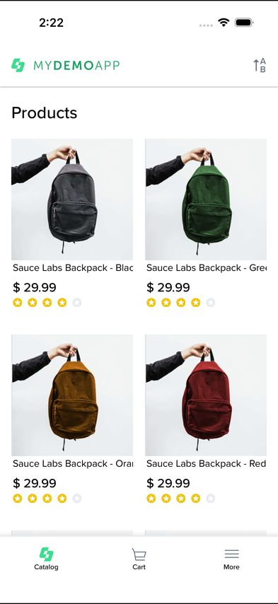
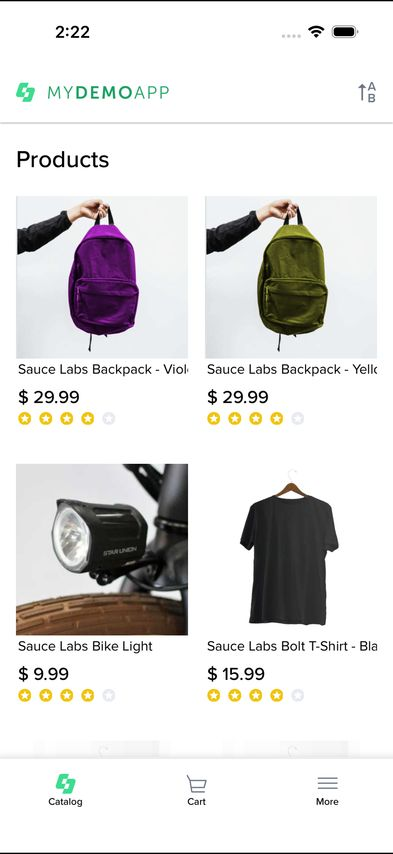
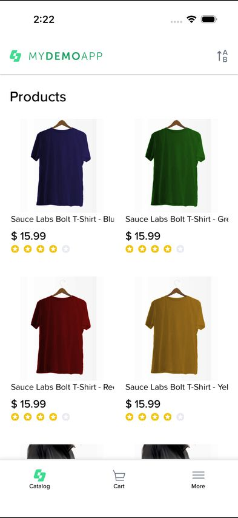
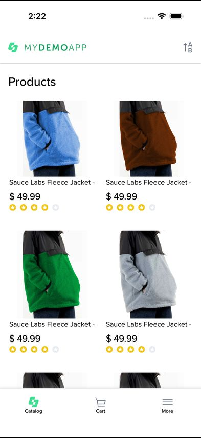
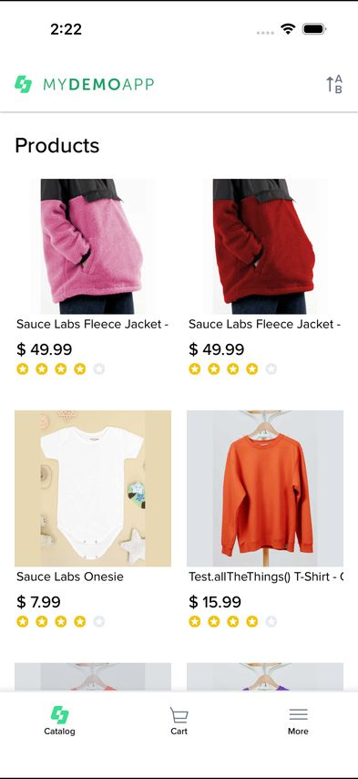
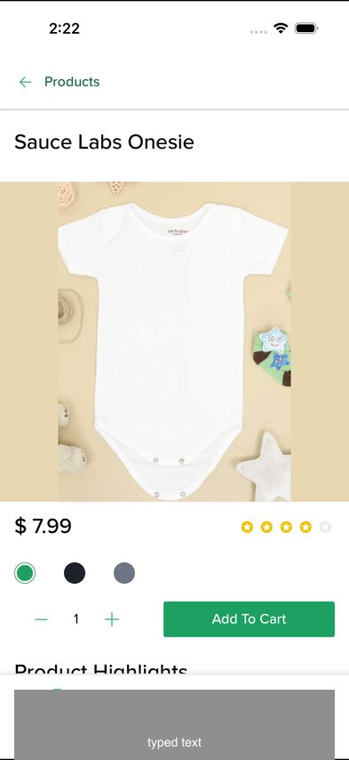

# Open the product that costs $7.99

**Passed in 20.9 s: Goal reached and all 2 expectations hold.**

Replayed with plain Appium in 15.4 s: passed

| | |
| --- | --- |
| Plan | `criteria/mydemo-ios/price-7-99.md` |
| Platform | iPhone 17, iOS 26.5 |
| Model | jev-1.13.0, looking with jev-1.14.0 |
| Requests | 11 requests (5 with a screenshot), 24,760 input tokens, about $0.0010 |
| Sent to the model | The text, with test data replaced by {name}, and 5 masked screenshots of steps 1, 2, 3, 4, 5, where the model looked. |
| Test | `benchmarks/2026-10-18-vision/hard-vision-always/round-1/price-7-99/generated/price-7-99.ios.spec.ts` |

## Plan

1. In the catalog, find the product whose price is $7.99, scrolling down if it isn't shown, and open it

Expected: id "AddToCart", text "Sauce Labs Onesie"

## Steps

### 1. scroll down the screen

- model: 0.39 sure of another action, goal 0.07, 189 ms
- on plan step 1
- looked at the screen (always): it chose this action instead (1.00 sure), 275 ms
- selector: (//XCUIElementTypeCollectionView)[1]

### 2. scroll down the screen

- model: 0.47 sure, goal 0.11, 139 ms
- on plan step 1
- looked at the screen (always): it confirmed the same action (0.99 sure), 127 ms
- selector: (//XCUIElementTypeCollectionView)[1]

### 3. scroll down the screen

- model: 0.36 sure of another action, goal 0.11, 131 ms
- on plan step 1
- looked at the screen (always): it chose this action instead (1.00 sure), 126 ms
- selector: (//XCUIElementTypeCollectionView)[1]

### 4. scroll down the screen

- model: 0.35 sure of another action, goal 0.11, 164 ms
- on plan step 1
- looked at the screen (always): it chose this action instead (0.99 sure), 131 ms
- selector: (//XCUIElementTypeCollectionView)[1]

### 5. tap "Sauce Labs Onesie"

- model: 0.46 sure of another action, goal 0.12, 133 ms
- on plan step 1
- looked at the screen (always): it chose this action instead (0.99 sure), 250 ms
- selector: //XCUIElementTypeCell[.//XCUIElementTypeStaticText[@label="Sauce Labs Onesie"]]
- a tap sent straight to the simulator changed nothing, so it was sent again through Appium, and taps go through Appium from now on

### 6. Goal reached

- model: 0.48 sure, goal 0.85, 157 ms
- on plan step 1
